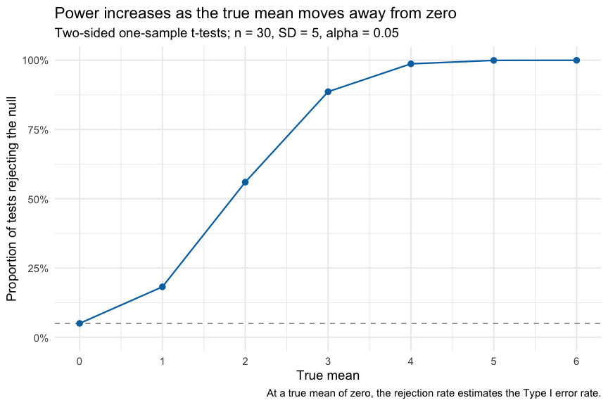
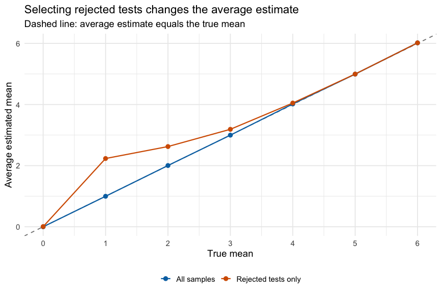

Homework 5
================
Zhiquan Chen

## Problem1

I simulated birthdays as independent draws from 365 equally likely days.
The function below returns `TRUE` if at least two people share a
birthday and `FALSE` otherwise.

``` r
simulate_birthday = function(group_size) {
  birthdays = sample(1:365, size = group_size, replace = TRUE)
  any(duplicated(birthdays))
}
```

``` r
set.seed(1)

birthday_results =
  tibble(group_size = 2:50) |>
  mutate(
    shared_birthday = map(
      group_size,
      \(n) map_lgl(
        seq_len(10000),
        \(iteration) simulate_birthday(group_size = n)
      )
    ),
    probability = map_dbl(shared_birthday, mean)
  )

stopifnot(
  nrow(birthday_results) == 49,
  all(lengths(birthday_results$shared_birthday) == 10000),
  all(birthday_results$probability >= 0),
  all(birthday_results$probability <= 1)
)
```

``` r
birthday_results |>
  ggplot(aes(x = group_size, y = probability)) +
  geom_hline(yintercept = 0.5, linetype = "dashed", color = "grey60") +
  geom_line(linewidth = 0.8, color = "#0072B2") +
  geom_point(size = 1.8, color = "#0072B2") +
  scale_x_continuous(breaks = c(2, 10, 20, 23, 30, 40, 50)) +
  scale_y_continuous(
    limits = c(0, 1),
    breaks = seq(0, 1, 0.25),
    labels = scales::label_percent()
  ) +
  labs(
    title = "Shared birthdays become more likely as the group grows",
    subtitle = "10,000 simulated groups at each group size",
    x = "Number of people in the group",
    y = "Probability of at least one shared birthday"
  )
```


For each group size, I averaged the results of 10,000 simulations. The
estimated probability of a shared birthday is 50.2% for 23 people and
97.2% for 50 people. The probability rises quickly because the number of
pairs of people increases with group size. A group of 23 people already
contains 253 possible pairs, so a shared birthday is fairly likely even
though there are 365 possible birthdays.

## Problem2

``` r
subject_files =
  tibble(
    file_path = list.files(
      "data",
      pattern = "^(con|exp)_[0-9]{2}\\.csv$",
      full.names = TRUE
    )
  ) |>
  mutate(
    file_name = basename(file_path),
    data = map(
      file_path,
      \(path) read_csv(
        path,
        col_types = cols(.default = col_double()),
        show_col_types = FALSE
      )
    )
  )

stopifnot(
  nrow(subject_files) == 20,
  all(map_int(subject_files$data, nrow) == 1),
  all(map_int(subject_files$data, ncol) == 8)
)
```

``` r
study_df =
  subject_files |>
  select(file_name, data) |>
  unnest(cols = data) |>
  mutate(participant_id = str_remove(file_name, "\\.csv$")) |>
  separate(
    participant_id,
    into = c("arm", "subject_id"),
    sep = "_",
    remove = FALSE
  ) |>
  mutate(
    arm = factor(
      arm,
      levels = c("con", "exp"),
      labels = c("Control", "Experimental")
    )
  ) |>
  pivot_longer(
    cols = starts_with("week_"),
    names_to = "week",
    names_prefix = "week_",
    names_transform = list(week = as.integer),
    values_to = "observation"
  ) |>
  select(participant_id, subject_id, arm, week, observation) |>
  arrange(arm, subject_id, week)

stopifnot(
  nrow(study_df) == 160,
  n_distinct(study_df$participant_id) == 20,
  all(count(study_df, participant_id)$n == 8),
  all(count(study_df, participant_id, week)$n == 1),
  !anyNA(study_df),
  identical(sort(unique(study_df$week)), 1:8)
)
```

I first created a dataframe of file names and used `map()` to read each
participant’s observations into a list column. I then expanded the list
column, extracted the arm and subject ID, and converted the eight weekly
columns to long format. The tidy dataset contains 160 observations from
20 participants followed for eight weeks. Each row represents one
participant at one week. Subject IDs are repeated across arms, so
`participant_id` combines the arm and subject ID to identify each person
uniquely.

``` r
arm_summary =
  study_df |>
  group_by(arm) |>
  summarise(
    participants = n_distinct(participant_id),
    week_1_mean = mean(observation[week == 1]),
    week_8_mean = mean(observation[week == 8]),
    mean_change = week_8_mean - week_1_mean,
    .groups = "drop"
  )

knitr::kable(
  arm_summary,
  digits = 2,
  col.names = c(
    "Arm", "Participants", "Week 1 mean", "Week 8 mean", "Mean change"
  ),
  caption = "Observed values at the first and last weeks by study arm"
)
```

| Arm          | Participants | Week 1 mean | Week 8 mean | Mean change |
|:-------------|-------------:|------------:|------------:|------------:|
| Control      |           10 |        0.92 |        0.74 |       -0.18 |
| Experimental |           10 |        1.14 |        5.12 |        3.98 |

Observed values at the first and last weeks by study arm

``` r
study_df |>
  ggplot(
    aes(
      x = week,
      y = observation,
      group = participant_id,
      color = arm
    )
  ) +
  geom_line(alpha = 0.75, linewidth = 0.7) +
  geom_point(alpha = 0.75, size = 1.5) +
  facet_wrap(~ arm, nrow = 1) +
  scale_color_manual(values = c(Control = "#0072B2", Experimental = "#D55E00")) +
  scale_x_continuous(breaks = 1:8) +
  guides(color = "none") +
  labs(
    title = "Weekly observations for each participant",
    subtitle = "Each line follows one participant; panels use the same y scale",
    x = "Week",
    y = "Observed value"
  )
```


The experimental group shows an overall upward pattern, while
observations in the control group fluctuate around a more stable level.
The experimental group mean increases from 1.14 in week 1 to 5.12 in
week 8. The corresponding control group means are 0.92 and 0.74.
Individual trajectories vary in both groups, but the separation between
groups is clearer by the later weeks.

## Problem3

``` r
simulate_t_test = function(mu, n = 30, sigma = 5) {
  x = rnorm(n, mean = mu, sd = sigma)

  t.test(x, mu = 0, alternative = "two.sided") |>
    broom::tidy() |>
    select(mu_hat = estimate, p_value = p.value)
}
```

``` r
set.seed(3)

simulation_results =
  tibble(true_mu = 0:6) |>
  mutate(
    results = map(
      true_mu,
      \(mu_value) tibble(iteration = seq_len(5000)) |>
        mutate(
          result = map(
            iteration,
            \(i) simulate_t_test(mu = mu_value)
          )
        ) |>
        unnest(cols = result)
    )
  ) |>
  unnest(cols = results) |>
  mutate(rejected = p_value < 0.05)

stopifnot(
  nrow(simulation_results) == 35000,
  all(count(simulation_results, true_mu)$n == 5000),
  !anyNA(simulation_results),
  all(between(simulation_results$p_value, 0, 1))
)
```

``` r
simulation_summary =
  simulation_results |>
  group_by(true_mu) |>
  summarise(
    n_sim = n(),
    rejections = sum(rejected),
    rejection_rate = mean(rejected),
    mean_estimate = mean(mu_hat),
    mean_estimate_rejected = mean(mu_hat[rejected]),
    .groups = "drop"
  )

simulation_summary |>
  select(true_mu, rejection_rate, mean_estimate, mean_estimate_rejected) |>
  knitr::kable(
    digits = 3,
    col.names = c(
      "True mean", "Rejection rate", "Mean estimate: all samples",
      "Mean estimate: rejected tests"
    ),
    caption = "Results from 5,000 simulations at each true mean"
  )
```

| True mean | Rejection rate | Mean estimate: all samples | Mean estimate: rejected tests |
|---:|---:|---:|---:|
| 0 | 0.050 | -0.001 | 0.005 |
| 1 | 0.182 | 0.997 | 2.233 |
| 2 | 0.560 | 2.003 | 2.624 |
| 3 | 0.886 | 2.997 | 3.189 |
| 4 | 0.987 | 4.017 | 4.048 |
| 5 | 0.999 | 4.994 | 4.996 |
| 6 | 1.000 | 6.017 | 6.018 |

Results from 5,000 simulations at each true mean

``` r
simulation_summary |>
  ggplot(aes(x = true_mu, y = rejection_rate)) +
  geom_hline(yintercept = 0.05, linetype = "dashed", color = "grey60") +
  geom_line(linewidth = 0.8, color = "#0072B2") +
  geom_point(size = 2.5, color = "#0072B2") +
  scale_x_continuous(breaks = 0:6) +
  scale_y_continuous(
    limits = c(0, 1),
    breaks = seq(0, 1, 0.25),
    labels = scales::label_percent()
  ) +
  labs(
    title = "Power increases as the true mean moves away from zero",
    subtitle = "Two-sided one-sample t-tests; n = 30, SD = 5, alpha = 0.05",
    x = "True mean",
    y = "Proportion of tests rejecting the null",
    caption = "At a true mean of zero, the rejection rate estimates the Type I error rate."
  )
```



With the sample size and standard deviation fixed, power increases as
the true mean moves farther from zero. The estimated power is 18.2% at a
true mean of 1, 56.0% at a true mean of 2, and 98.7% at a true mean of
4. Larger effects are easier to distinguish from sampling variability.
At a true mean of zero, the null hypothesis is true, so the rejection
rate of 5.0% estimates the Type I error rate, which is close to the
chosen 5% significance level.

``` r
estimate_plot_df =
  simulation_summary |>
  select(true_mu, mean_estimate, mean_estimate_rejected) |>
  pivot_longer(
    cols = c(mean_estimate, mean_estimate_rejected),
    names_to = "sample_set",
    values_to = "average_estimate"
  ) |>
  mutate(
    sample_set = factor(
      sample_set,
      levels = c("mean_estimate", "mean_estimate_rejected"),
      labels = c("All samples", "Rejected tests only")
    )
  )

estimate_plot_df |>
  ggplot(aes(x = true_mu, y = average_estimate, color = sample_set)) +
  geom_abline(slope = 1, intercept = 0, linetype = "dashed", color = "grey50") +
  geom_line(linewidth = 0.8) +
  geom_point(size = 2.5) +
  scale_color_manual(
    values = c("All samples" = "#0072B2", "Rejected tests only" = "#D55E00")
  ) +
  scale_x_continuous(breaks = 0:6) +
  labs(
    title = "Selecting rejected tests changes the average estimate",
    subtitle = "Dashed line: average estimate equals the true mean",
    x = "True mean",
    y = "Average estimated mean",
    color = NULL
  )
```



Across all samples, the average estimated mean is close to the true
mean. Among rejected tests, the average estimate is higher than the true
mean when the true effect is small and positive. For example, at a true
mean of 1, the average estimate is 1.00 across all samples and 2.23
among rejected tests. Rejection depends on the sample mean relative to
its estimated standard error. When the true positive effect is small,
samples with unusually large positive means are more likely to pass the
rejection threshold, so retaining only rejected tests inflates the
average estimate. As power approaches one, almost all samples are
retained and the two averages converge.

At a true mean of zero, the two-sided test selects extreme means in both
directions. Symmetry makes the conditional mean zero in expectation,
even though the selected estimates tend to be farther from zero. In this
finite simulation, the average estimate among rejected tests is 0.0046;
its departure from zero reflects Monte Carlo variability.
