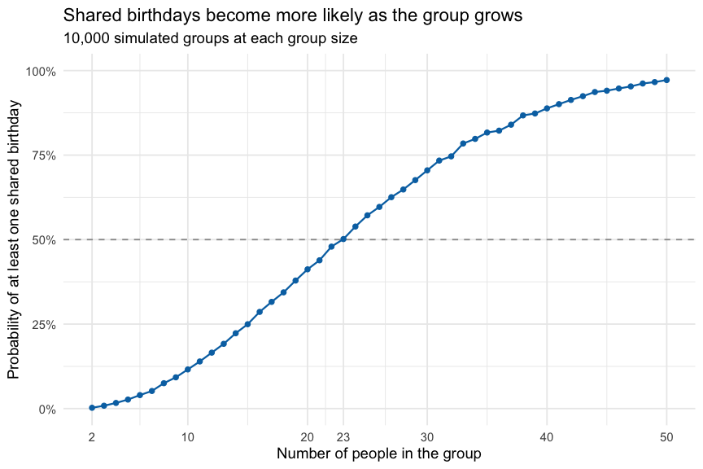
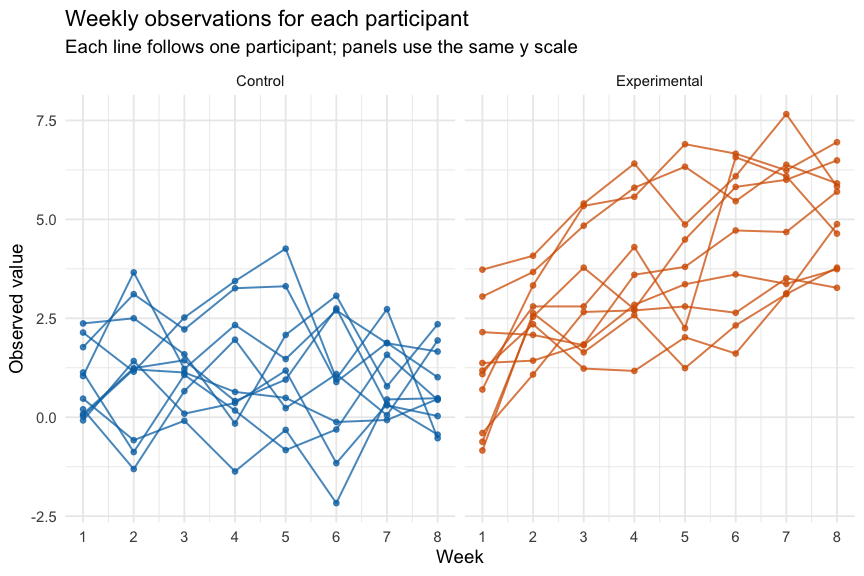

Homework 5
================
Zhiquan Chen

## Problem1

I simulated birthdays as independent draws from 365 equally likely days.
The function below returns `TRUE` if at least two people share a
birthday and `FALSE` otherwise.

``` r
simulate_birthday = function(group_size) {
  birthdays = sample(1:365, size = group_size, replace = TRUE)
  any(duplicated(birthdays))
}
```

``` r
set.seed(1)

birthday_results =
  tibble(group_size = 2:50) |>
  mutate(
    shared_birthday = map(
      group_size,
      \(n) map_lgl(
        seq_len(10000),
        \(iteration) simulate_birthday(group_size = n)
      )
    ),
    probability = map_dbl(shared_birthday, mean)
  )

stopifnot(
  nrow(birthday_results) == 49,
  all(lengths(birthday_results$shared_birthday) == 10000),
  all(birthday_results$probability >= 0),
  all(birthday_results$probability <= 1)
)
```

``` r
birthday_results |>
  ggplot(aes(x = group_size, y = probability)) +
  geom_hline(yintercept = 0.5, linetype = "dashed", color = "grey60") +
  geom_line(linewidth = 0.8, color = "#0072B2") +
  geom_point(size = 1.8, color = "#0072B2") +
  scale_x_continuous(breaks = c(2, 10, 20, 23, 30, 40, 50)) +
  scale_y_continuous(
    limits = c(0, 1),
    breaks = seq(0, 1, 0.25),
    labels = scales::label_percent()
  ) +
  labs(
    title = "Shared birthdays become more likely as the group grows",
    subtitle = "10,000 simulated groups at each group size",
    x = "Number of people in the group",
    y = "Probability of at least one shared birthday"
  )
```



For each group size, I averaged the results of 10,000 simulations. The
estimated probability of a shared birthday is 50.2% for 23 people and
97.2% for 50 people. The probability rises quickly because the number of
pairs of people increases with group size. A group of 23 people already
contains 253 possible pairs, so a shared birthday is fairly likely even
though there are 365 possible birthdays.

## Problem2

``` r
subject_files =
  tibble(
    file_path = list.files(
      "data",
      pattern = "^(con|exp)_[0-9]{2}\\.csv$",
      full.names = TRUE
    )
  ) |>
  mutate(
    file_name = basename(file_path),
    data = map(
      file_path,
      \(path) read_csv(
        path,
        col_types = cols(.default = col_double()),
        show_col_types = FALSE
      )
    )
  )

stopifnot(
  nrow(subject_files) == 20,
  all(map_int(subject_files$data, nrow) == 1),
  all(map_int(subject_files$data, ncol) == 8)
)
```

``` r
study_df =
  subject_files |>
  select(file_name, data) |>
  unnest(cols = data) |>
  mutate(participant_id = str_remove(file_name, "\\.csv$")) |>
  separate(
    participant_id,
    into = c("arm", "subject_id"),
    sep = "_",
    remove = FALSE
  ) |>
  mutate(
    arm = factor(
      arm,
      levels = c("con", "exp"),
      labels = c("Control", "Experimental")
    )
  ) |>
  pivot_longer(
    cols = starts_with("week_"),
    names_to = "week",
    names_prefix = "week_",
    names_transform = list(week = as.integer),
    values_to = "observation"
  ) |>
  select(participant_id, subject_id, arm, week, observation) |>
  arrange(arm, subject_id, week)

stopifnot(
  nrow(study_df) == 160,
  n_distinct(study_df$participant_id) == 20,
  all(count(study_df, participant_id)$n == 8),
  all(count(study_df, participant_id, week)$n == 1),
  !anyNA(study_df),
  identical(sort(unique(study_df$week)), 1:8)
)
```

I first created a dataframe of file names and used `map()` to read each
participant’s observations into a list column. I then expanded the list
column, extracted the arm and subject ID, and converted the eight weekly
columns to long format. The tidy dataset contains 160 observations from
20 participants followed for eight weeks. Each row represents one
participant at one week. Subject IDs are repeated across arms, so
`participant_id` combines the arm and subject ID to identify each person
uniquely.

``` r
arm_summary =
  study_df |>
  group_by(arm) |>
  summarise(
    participants = n_distinct(participant_id),
    week_1_mean = mean(observation[week == 1]),
    week_8_mean = mean(observation[week == 8]),
    mean_change = week_8_mean - week_1_mean,
    .groups = "drop"
  )

knitr::kable(
  arm_summary,
  digits = 2,
  col.names = c(
    "Arm", "Participants", "Week 1 mean", "Week 8 mean", "Mean change"
  ),
  caption = "Observed values at the first and last weeks by study arm"
)
```

| Arm          | Participants | Week 1 mean | Week 8 mean | Mean change |
|:-------------|-------------:|------------:|------------:|------------:|
| Control      |           10 |        0.92 |        0.74 |       -0.18 |
| Experimental |           10 |        1.14 |        5.12 |        3.98 |

Observed values at the first and last weeks by study arm

``` r
study_df |>
  ggplot(
    aes(
      x = week,
      y = observation,
      group = participant_id,
      color = arm
    )
  ) +
  geom_line(alpha = 0.75, linewidth = 0.7) +
  geom_point(alpha = 0.75, size = 1.5) +
  facet_wrap(~ arm, nrow = 1) +
  scale_color_manual(values = c(Control = "#0072B2", Experimental = "#D55E00")) +
  scale_x_continuous(breaks = 1:8) +
  guides(color = "none") +
  labs(
    title = "Weekly observations for each participant",
    subtitle = "Each line follows one participant; panels use the same y scale",
    x = "Week",
    y = "Observed value"
  )
```



The experimental group shows an overall upward pattern, while
observations in the control group fluctuate around a more stable level.
The experimental group mean increases from 1.14 in week 1 to 5.12 in
week 8. The corresponding control group means are 0.92 and 0.74.
Individual trajectories vary in both groups, but the separation between
groups is clearer by the later weeks.
